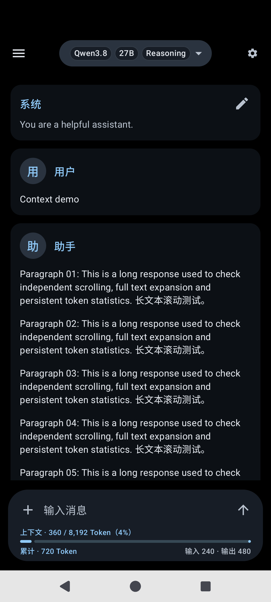
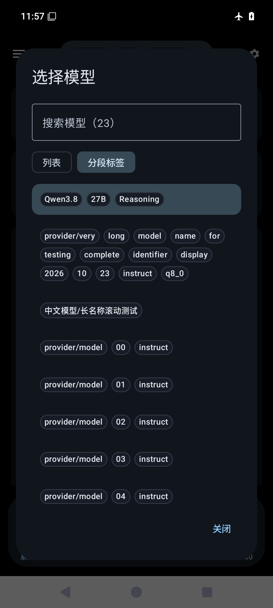

# Chat controls, token accounting and interface languages

The composer separates the current branch's context size from cumulative request
usage. For example, two requests that each report 120 input and 240 output tokens
show a latest context size of 360 and cumulative usage of 720, not a context size
of 720. The synthetic screenshots below illustrate this distinction.

| Context and conversation usage | Segmented model labels |
| --- | --- |
|  |  |

## Context and cumulative usage

- Completed context measurements use the latest request's input plus output.
  For tool continuations, this means the last request, not the sum of tool rounds.
- A fingerprint of the branch, endpoint and model prevents edited messages or
  model changes from reusing a stale measurement. Older imported histories
  without this fingerprint fall back to a labelled estimate.
- Drafts, unfinished replies and missing usage show `≈`. The fallback estimates
  text only; tool schemas, tokenizer differences and media can affect the actual
  request. Uncounted media is explained in the details dialog. This is not a
  server KV-cache measurement or an exact tokenizer for the next request.
- Capacity comes from explicit `/models` fields, or the configured `n_ctx` in a
  single-model llama.cpp `/props` response. A global capacity is not applied to
  all models behind a router. Model-name fragments and training context sizes
  are not interpreted as the active server capacity.
- Cumulative usage accounts for each request once, including tool continuations.
  Repeated cumulative usage chunks update the existing record. Zero is distinct
  from unknown, and incomplete requests are marked partial. Usage persists in
  message metadata and travels with import/export.
- Composer totals include all retained branches of the selected conversation.
  Deleted replies are excluded. Chat properties also show branch statistics,
  and Settings provides an aggregate over saved history. These are local records,
  not a provider billing ledger.
- Landscape keyboard mode uses a compact, horizontally scrollable statistics
  row. Tapping either layout opens the same details dialog.

## Other controls

- **Trust user-installed certificates** is off by default. When enabled, API
  and MCP connections use enabled system and user CAs from Android's CA store.
  Certificate-chain and hostname checks remain enabled; opting out evicts the
  alternate connection pool. Restart after changing installed certificates.
  This does not select an mTLS client certificate and does not change the Fetch
  URL tool or Markdown image-loading policy.
- **Automatically name new chats** uses a local summary of the first message or
  attachment name, with Unicode-safe truncation. Manual titles are preserved;
  naming does not make an extra model request.
- **List / Tags** changes the model picker and selected-model pill. Tags split
  only at `-`, preserve `/` and `_`, and never alter the API model identifier.
  The searchable dialog adapts to available width up to 840 dp; long labels wrap
  or scroll. Identifier order is preserved in right-to-left interfaces.
- **Scroll long messages** bounds long message and expanded reasoning bodies
  to 420 dp, with expand, top and bottom controls. The full text is retained.

## Interface languages and provenance

Settings offers system default and 66 language/region options, with 246 UI-owned
strings per option. Catalogs are bundled in `app/src/main/assets/i18n`; switching
works offline and persists. Search accepts native names, English names and
language tags. Chat messages, custom prompts, model identifiers and protocol
fields are not translated. Raw server errors can remain in their original
language.

Simplified Chinese was curated; Traditional Chinese was converted with OpenCC
and adjusted. The other catalogs were generated locally using
[NLLB-200 distilled 600M](https://huggingface.co/facebook/nllb-200-distilled-600M)
through [CTranslate2 int8 weights](https://huggingface.co/JustFrederik/nllb-200-distilled-600M-ct2-int8),
then corrected for basic controls and selected terminology. Serbian Latin is a
transliteration of the Cyrillic catalog; Portuguese variants share a base.
The translation model's card identifies its CC-BY-NC-4.0 license. Model weights
and translation runtimes are not included in the app or this contribution.
The model SHA-256 used during generation was
`ed1beaf75134de7505315a5223162f56acff397eff6b50638a500d3936fe707b`.

**The machine-assisted catalogs have not all been reviewed by native speakers.**
Complete key and placeholder coverage establishes structural validity, not
linguistic quality. This part of the contribution is a review draft. Corrections
can be made directly in the relevant JSON file, preserving the English keys and
numbered `{0}` placeholders.

Validate catalogs without rewriting them:

```sh
python tools/validate_i18n.py
```

## Validation and limits

- 212 JVM tests passed with no failures, errors or skipped tests, including CA
  trust/hostname rejection, usage accounting, context invalidation, capacity
  parsing, local naming, model splitting and locale/placeholder behavior.
- Android Lint reported 0 errors and 16 warnings.
- An Android 15 / API 35 x86_64 emulator with a synthetic local API verified
  context versus cumulative counts, drafts, persistence, model tags, long names,
  Chinese/Japanese/Arabic layouts and landscape keyboard statistics.
- Earlier verification of the same CA implementation rejected a local test CA
  in system-only mode, accepted model listing and streaming with user CA trust
  enabled, then rejected it again after disabling the option.
- ARM64 Release compilation and APK signature checks passed for the local
  delivery. Physical ARM64 devices, OEM certificate managers, live provider
  endpoints and complete MCP TLS workflows were not tested end to end.

The Gradle properties `maid.ndkVersion` and `maid.testAbi` optionally select an
installed NDK and emulator ABI without changing the normal NDK/ARM64 defaults.
This contribution leaves upstream release versioning unchanged.
